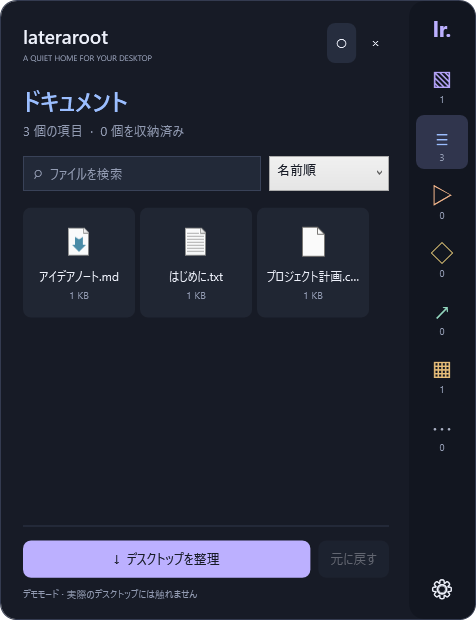

# lateraroot

**デスクトップに、静かな居場所を。**

Windows の画面端にファイルをまとめる、小さなオープンソースのデスクトップ整理アプリです。スタックにカーソルを合わせるとファイル一覧が開き、離れると閉じます。



## ダウンロード・起動

1. [Releases](https://github.com/MonoV0/lateraroot/releases) から `lateraroot-*-win-x64.zip` をダウンロードします。
2. ZIP を任意のフォルダーへ**すべて展開**します。
3. `Lateraroot.exe` を起動します。右端に小さなレールが表示されます。

Windows 10 / 11（64 bit）向けです。配布 ZIP は .NET 同梱で、管理者権限や別途ランタイムのインストールは不要です。初期版はコード署名がありません。

## 使い方

- **見る:** 画面端のスタックにカーソルを合わせます。ファイルをクリックすると既定のアプリで開きます。
- **探す:** スタック内をファイル名で検索し、名前・更新日・種類・サイズで並び替えられます。更新日とサイズは降順です。
- **片付ける:** 「デスクトップを整理」を押し、内容を確認すると、ユーザーのデスクトップ直下にある通常のファイルとフォルダーを保管領域へ移動します。対象は全スタックです。新しいファイルは自動移動しません。
- **戻す:** 「元に戻す」は選択中スタックの収納済み項目を復元します。1件ずつ戻す場合はファイルを右クリックします。同名項目がある場合は ` (restored 1)` などを付け、既存ファイルを残します。
- **設定:** レール下部の ⚙ から、右端／左端、ディスプレイ、閉じるまでの時間、スタック名・記号・分類ルール・優先順位を変更できます。スタックは最大16個です。
- **固定:** パネル上部の ○ で開いたままにします。Esc で閉じます。
- **呼び出す:** `Ctrl+Alt+Space` で開閉できます。競合時は通知領域のアイコンから開いてください。
- **終了:** 通知領域の Lateraroot を右クリック →「終了」。サインイン時の起動は設定から任意で有効にできます。

初期スタックは画像、ドキュメント、メディア、アーカイブ、ショートカット、フォルダー、その他です。

### 分類ルールの例

| スタック | ルール |
| --- | --- |
| 仕事の資料 | `.pdf, .docx, .xlsx, .pptx` |
| スクリーンショット | `.png, .jpg, .webp` |
| フォルダー | `<folders>` |
| その他 | `*` |

拡張子の大文字・小文字は区別せず、`.pdf`、`pdf`、`*.pdf` を使えます。拡張子が重なるときは上のルールが優先されます。`*` はほかのルールに一致しない項目専用です。設定を変更すると収納済みファイルも再分類されます。

## ファイルとデータ

起動しただけではファイルを移動しません。通常のデスクトップを一覧表示し、明示的に「整理」を実行したときだけ収納します。共有デスクトップは表示のみです。隠し項目、システム項目、ジャンクション／シンボリックリンクは対象外です。`.lnk` ショートカット自体は収納できます。

標準の保存先は `%LOCALAPPDATA%\Lateraroot\Data` です。

| ファイル・フォルダー | 内容 |
| --- | --- |
| `settings.json` | 配置・スタック・並び順 |
| `library.json` | 元のパスと収納先の復元記録 |
| `Vault\<id>\<元の名前>` | 実ファイル |

移動前に復元記録をディスクへ保存します。アプリが終了しても実ファイルは `Vault` に残り、エクスプローラーからアクセスできます。バックアップは **Data フォルダー全体**を保存してください。アプリを削除する前に、各スタックの「元に戻す」で必要な項目を復元してください。収納中のファイルは元のパスが変わるため、ほかのアプリの参照先やショートカットのリンク先に影響する場合があります。

アプリ内のネットワーク通信・アカウント・テレメトリーはありません。シェルのアイコン取得やファイルを開く際は Windows の関連付けが使われます。

## 開発

[.NET 10 SDK](https://dotnet.microsoft.com/download/dotnet/10.0) と Windows が必要です。WPF / Windows Forms の標準ライブラリを使い、外部のアプリケーション用 NuGet パッケージには依存しません。

```powershell
dotnet build src/Lateraroot/Lateraroot.csproj -c Release
dotnet run --project tests/Lateraroot.Core.Tests -c Release
dotnet run --project src/Lateraroot -- --demo
```

`--demo` では実際のデスクトップと切り離したサンプルを作成します。実装テスト用の保存先を指定することもできます。

```powershell
dotnet run --project src/Lateraroot -- --demo --data-dir C:\temp\lateraroot-demo
dotnet run --project src/Lateraroot -- --data-dir C:\temp\lateraroot-data --desktop-dir C:\temp\test-desktop
```

`--desktop-dir` を指定すると共有デスクトップ表示・サインイン時起動は無効になります。保存先を対象デスクトップの中に置くことはできません。

WPF の描画・配置・検索・収納状態の連携を確認する UI スモークテストも実行できます。毎回新しい保存先を指定してください。結果 JSON と描画 PNG が保存先の `verification` に作成されます。実際のマウス入力を行うテストではありません。

```powershell
dotnet run --project src/Lateraroot -- --demo --verify-ui --data-dir C:\temp\lateraroot-ui-test
```

配布用ビルド:

```powershell
dotnet publish src/Lateraroot/Lateraroot.csproj -c Release -r win-x64 --self-contained true -o artifacts/win-x64
```

GitHub Actions でもテストと Windows 向けビルドを実行します。`v*` タグを push すると ZIP と SHA-256 をリリースに添付します。

## 現在の範囲

Windows 向けの初期バージョンです。画面端は左右に対応し、レールは選択した1画面に配置します。ファイル名パターンや日付による分類、ドラッグ＆ドロップでの任意グループへの登録、上下端への配置には未対応です。並び順は全スタック共通です。

フォルダーの移動は同一ボリュームでの移動に対応します。別ボリュームや使用中の項目など移動できないものはそのまま残し、結果を表示します。OneDrive 等の同期・オンライン専用ファイルは利用環境に依存します。複数画面・異なる DPI 向けの処理は実装していますが、全ハードウェア構成で検証済みではありません。

## Contributing / License

[CONTRIBUTING.md](CONTRIBUTING.md) を参照してください。MIT License。

---

**English:** Lateraroot is a Windows desktop organizer with hover-to-expand edge stacks. Configure extension-based groups, search and sort files, explicitly move desktop items into a local vault, and restore them without overwriting existing files. Data stays local. Build with .NET 10 SDK; portable x64 releases include the runtime. See the Japanese guide above for commands, storage details, and current limitations.
