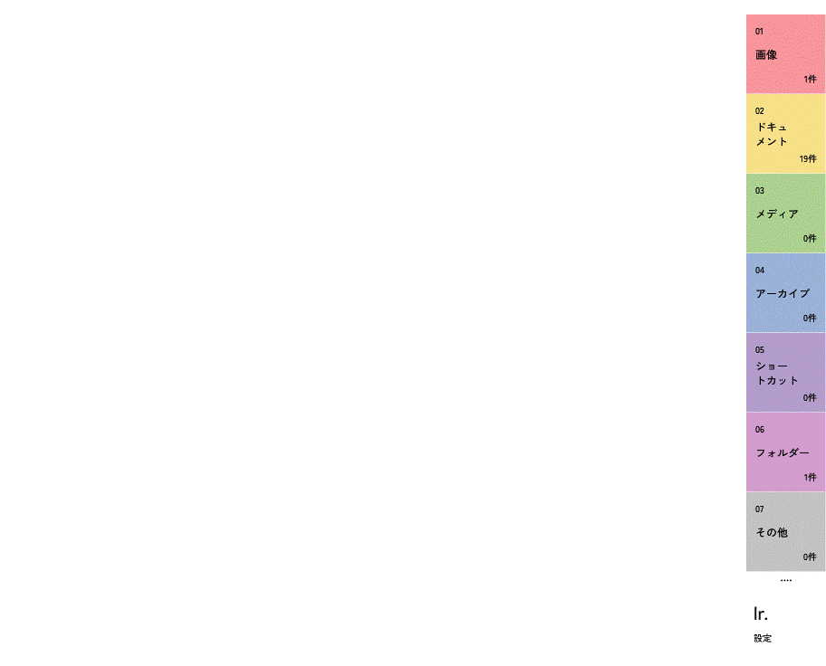
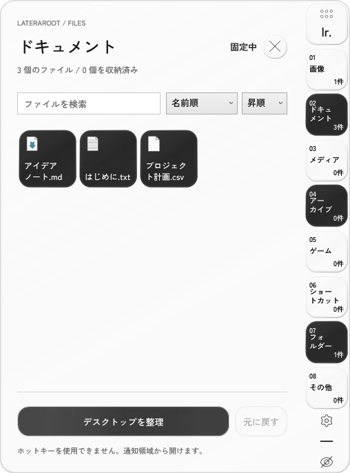
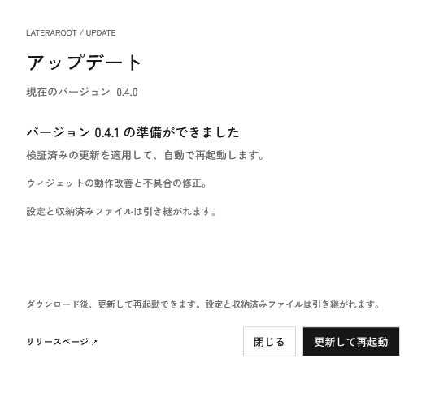
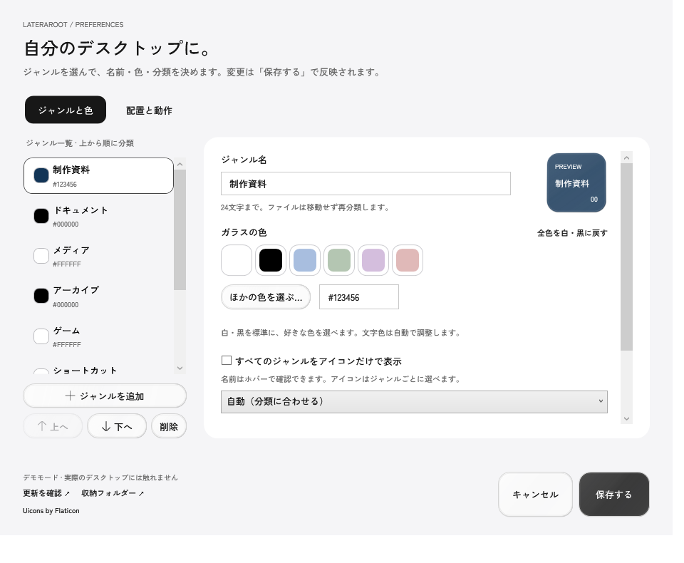

# lateraroot

**Windows file widgets.**

**mainはv0.8.0の開発版です。** ゲーム分類・昇降順・ジャンルのアイコン表示を追加しています。最新の正式公開版はv0.7.2です。背景を屈折させるLiquid Glass描画は未実装で、完成したガラスデザインとしての新規正式リリースは行っていません。

ファイルをジャンルごとの正方形ウィジェットで扱う、Windows向けのデスクトップカスタマイズアプリです。白・黒を標準にしたLiquid Glass風の半透明素材で、画面端へ配置し、ホバー・クリックでファイルを展開します。通常のアプリを使う間は、同じライブラリをコンパクトなレールから呼び出せます。



プレビューはアプリ自身のWPF描画を生成した無彩色の背景へ合成したものです。実際のデスクトップ画像ではありません。カテゴリもファイルも同じ正方形で、余った領域は透過します。

[静止画](docs/desktop-expanded.png) · [設定画面](docs/settings.png) · [設計と参考資料](docs/DESIGN.md)

開発版の[アイコンのみ表示](docs/compact-icons.png)・[ゲームの分類](docs/games.png)も確認できます。



## ダウンロード・起動

1. [Releases](https://github.com/MonoV0/lateraroot/releases) から `lateraroot-*-win-x64.zip` をダウンロードします。
2. ZIP を任意のフォルダーへ**すべて展開**します。
3. 展開先の直下にある `Lateraroot.exe` を起動します。`current` や `Update.exe` も同じ場所に保ってください。デスクトップでは正方形のファイルウィジェット、アプリの作業中はコンパクトなレールが表示されます。

**v0.3以前からは最初の1回だけ手動更新が必要です。** 通知領域から旧版を終了し、v0.4以降のZIPを別フォルダーへ展開して起動してください。分類設定と収納履歴は同じ保存先から読み込みます。サインイン時起動を利用中で実行ファイルの場所を変えた場合は、設定で一度オフ→オンにして起動先を更新してください。

### アプリ内アップデート



通知領域を右クリック →「更新を確認」、または設定の「更新を確認」から、**確認 → ダウンロード → 更新して再起動**を実行できます。設定画面から実行する場合は、編集中の設定を保存して更新します。ファイルの整理・復元中は再起動できません。

起動時と1日ごとに新しい正式リリースを確認し、見つかると通知します。自動でダウンロードや適用はしません。「新しいバージョンを自動で確認」は設定からオフにできます。通信エラーは再試行でき、ダウンロード中は中止できます。検証に失敗した更新は適用しません。ダウンロード後に閉じた場合も、次回起動時に「更新して再起動」で適用できます。

更新対象はアプリ本体です。`%LOCALAPPDATA%\Lateraroot\Data` の設定・収納履歴・実ファイルを残します。ZIP全体を書き込み可能なフォルダーへ展開して使ってください。開発用の `dotnet run`、素のpublishフォルダー、デモではアプリ内更新を無効にし、リリースページを案内します。

Windows 10 / 11（64 bit）向けです。配布 ZIP は .NET 同梱で、管理者権限や別途ランタイムのインストールは不要です。初期版はコード署名がありません。

## 使い方

- **見る:** カテゴリの正方形へホバー、またはクリックすると、同じサイズのファイルが端から順に現れます。`OPEN` で複数行、`CLOSE` で1行へ戻します。ファイルはクリックで開きます。ホイールや Page Up / Page Down で一覧を送れます。
- **探す・整理する:** ウィジェットを右クリック →「検索・整理」、または一覧にフォーカスして Ctrl+F。名前／更新日時／種類／サイズと、昇順・降順を選べます。右クリックの「ファイルの並び順」と設定からも変更でき、デスクトップ・コンパクト表示で共有します。並べ替えでディスクは読み直しません。
- **片付ける:** 「デスクトップを整理」を押し、内容を確認すると、ユーザーのデスクトップ直下にある通常のファイルとフォルダーを保管領域へ移動します。対象は全スタックです。新しいファイルは自動移動しません。
- **戻す:** 「元に戻す」は選択中スタックの収納済み項目を復元します。1件ずつ戻す場合はファイルを右クリックします。同名項目がある場合は ` (restored 1)` などを付け、既存ファイルを残します。
- **設定:** `lr.` の正方形、右クリックメニュー、または通知領域から開きます。「ジャンルと色」で名前・色・分類・優先順位、「配置と動作」でサイズ（標準88 DIP、72〜112 DIP）・画面端・ディスプレイ・位置・透明効果・動きを編集します。ジャンルは最大16個です。画面が狭い場合は正方形を保って複数列へ収めます。
- **移動:** `lr.` 上部のハンドルやコンパクト表示のハンドルをドラッグすると、近い画面端へ吸着します。ほかのディスプレイへも移動できます。設定の位置スライダーはキーボードでも調整できます。位置は保存されます。
- **配置をロック:** 右クリック・通知領域の「配置をロック」、または設定の「配置と動作」から、ドラッグ移動を止められます。ファイルを開く・展開する操作はそのまま使えます。設定画面の端・画面・位置による配置変更も可能です。
- **一覧を再読み込み:** 右クリック・通知領域の「一覧を再読み込み」、または一覧／ウィジェットにフォーカスしてF5。ファイル監視を張り直して最新の一覧を取得します。
- **最小化:** `−` で小さなタブにします。タブの `↗` で戻せます。タブもドラッグできます。
- **非表示:** コンパクト表示の `×` や右クリックの「非表示」で、ウィジェットと一覧を隠します。終了はせず、通知領域の「表示する」または `Ctrl+Alt+Space` で戻せます。最小化・非表示の選択も次回起動時に引き継ぎます。
- **固定:** インスペクター上部の「固定」で開いたままにします。Esc で閉じます。
- **動き:** 初期設定からアニメーションを有効にします。展開は端からの短いスライドと段階的な表示、収納・最小化・非表示は短いフェードです。素早い再ホバーで収納を中断できます。「動きを減らす」で即時表示へ、「Windowsのアニメーション設定に合わせる」でOSに従う動作へ切り替えられます。Windows自体の設定は変更しません。
- **呼び出す:** `Ctrl+Alt+Space` で一覧を開閉し、非表示・最小化中は表示を戻します。競合時は通知領域のアイコンから開いてください。
- **終了:** 通知領域の Lateraroot を右クリック →「終了」。サインイン時の起動は設定から任意で有効にできます。

開発版の初期ジャンルは画像、ドキュメント、メディア、アーカイブ、ゲーム、ショートカット、フォルダー、その他です。標準色は白・黒です。更新時は保存済みのジャンル・色を保持します。以前の標準ショートカット分類があり、16個の上限に空きがあれば、ゲーム分類をその直前へ一度だけ追加します。削除したゲーム分類を再作成したり、独自ルールを上書きしたりしません。

### ゲームの自動分類・アイコンのみ表示（開発版）

- ゲームはデスクトップにある `.url` の起動URLと `.lnk` の起動先・引数から判定します。SteamのゲームID、Epicのゲーム起動URL、GOG・Riotなどのゲーム起動引数、既知のゲーム保存先へのリンクが対象です。通常のWebサイトや、起動引数のないSteamアプリだけのリンクはゲームにしません。すべてのゲームを網羅する判定ではありません。
- ゲーム本体やランチャーのアカウントへアクセスせず、ドライブ全体を検索しません。判定で起動や移動は行いません。明示的に「整理」を実行した場合も、収納するのはデスクトップのショートカット自体です。
- 設定で分類方法に「ゲーム」を選べます。ほかのルールと同じく、上のジャンルを優先します。判定できないものは独自の分類ルールで補えます。
- 「すべてのジャンルをアイコンだけで表示」をオンにすると、両方の表示でジャンル名・番号・件数をアイコンに置き換えます。名前はホバーと読み上げ用ラベルへ残します。各ジャンルのアイコンは自動選択または8種類から指定でき、保存前にプレビューできます。
- ジャンル自体の並びは、左のジャンル一覧の「上へ／下へ」で変えます。

### ジャンルと色を自分で決める



1. 設定の「ジャンルと色」で、左の一覧から編集するジャンルを選びます。
2. 名前を入力し、色見本を押すか「ほかの色を選ぶ…」で好きな色を選びます。`#RRGGBB` の入力にも対応します。実際のガラス素材でプレビューし、文字色は自動で調整します。
3. 分類方法を「拡張子を指定」「フォルダー」「ゲーム」から選びます。拡張子は `.pdf, .docx` のように入力します。上のジャンルほど優先します。
4. 「＋ ジャンルを追加」「↑ 上へ」「↓ 下へ」「削除」で一覧を編集し、「保存する」で反映します。「キャンセル」は保存前の変更を破棄します。

「その他」は未分類ファイル用に1つ残します。名前と色は変更できます。「全色を白・黒に戻す」は、ジャンル名と分類ルールを保って色だけを白・黒にします。古い版の標準カラーから切り替える場合にも使えます。ジャンル構成も初期状態へ戻す場合は「配置と動作」の「ジャンルと分類を標準に戻す」を使ってください。

ガラスは半透明の着色・反射・細い光沢の縁を重ねたWindows向けの表現です。AppleのネイティブLiquid Glass素材や、背景をぼかす・屈折させる機能ではありません。色はガラスの着色として見えるため、壁紙によって見え方が変わります。「透明効果を減らす」で不透明にでき、Windowsのハイコントラスト設定時も不透明表示になります。

デスクトップ用はシェルの上・通常アプリの下の表示順です。最前面固定の大きなパネルにはしません。正方形は辺の長さを固定し、画面の高さへ引き伸ばしません。表示はタスクバーを除く作業領域に沿います。通常の Windows デスクトップが前面になったことをイベントで判定します。エクスプローラーのフォルダー画面はデスクトップとして扱いません。自分の設定画面を操作中は元の表示を維持します。

### 分類ルールの例

| スタック | ルール |
| --- | --- |
| 仕事の資料 | `.pdf, .docx, .xlsx, .pptx` |
| スクリーンショット | `.png, .jpg, .webp` |
| フォルダー | `<folders>` |
| その他 | `*` |

拡張子の大文字・小文字は区別せず、`.pdf`、`pdf`、`*.pdf` を使えます。拡張子が重なるときは上のルールが優先されます。`*` はほかのルールに一致しない項目専用です。設定を変更すると収納済みファイルも再分類されます。

## ファイルとデータ

起動しただけではファイルを移動しません。通常のデスクトップを一覧表示し、明示的に「整理」を実行したときだけ収納します。共有デスクトップは表示のみです。隠し項目、システム項目、ジャンクション／シンボリックリンクは対象外です。`.lnk` ショートカット自体は収納できます。

標準の保存先は `%LOCALAPPDATA%\Lateraroot\Data` です。

| ファイル・フォルダー | 内容 |
| --- | --- |
| `settings.json` | 配置・スタック・並び順 |
| `library.json` | 元のパスと収納先の復元記録 |
| `Vault\<id>\<元の名前>` | 実ファイル |

移動前に復元記録をディスクへ保存します。アプリが終了しても実ファイルは `Vault` に残り、エクスプローラーからアクセスできます。バックアップは **Data フォルダー全体**を保存してください。アプリを削除する前に、各スタックの「元に戻す」で必要な項目を復元してください。収納中のファイルは元のパスが変わるため、ほかのアプリの参照先やショートカットのリンク先に影響する場合があります。

更新の自動確認が有効なとき、または手動で確認・ダウンロードしたときに、GitHubの公開リリースAPIと配布先へHTTPS通信します。設定・ファイル名・収納データは送信しません。GitHubアカウントやテレメトリーは使いません。シェルのアイコン取得やファイルを開く際は Windows の関連付けが使われます。

## 開発

[.NET 10 SDK](https://dotnet.microsoft.com/download/dotnet/10.0) と Windows が必要です。WPF / Windows Forms と、更新用の [Velopack](https://github.com/velopack/velopack) 1.2.161（MIT）を使います。WebViewは使いません。

メインフォントは同梱の **Zen Kaku Gothic New Medium** です。Windows へのフォントインストールは不要です。Light / Regular は未使用のため同梱していません。

```powershell
./scripts/Prepare-Icons.ps1 # Windows / PowerShell 7。公式Flaticonから検証済みアイコンを準備
dotnet build src/Lateraroot/Lateraroot.csproj -c Release
dotnet run --project tests/Lateraroot.Core.Tests -c Release
dotnet run --project src/Lateraroot -- --demo
```

`--demo` では実際のデスクトップと切り離したサンプルを作成します。実装テスト用の保存先を指定することもできます。

```powershell
dotnet run --project src/Lateraroot -- --demo --data-dir C:\temp\lateraroot-demo
dotnet run --project src/Lateraroot -- --data-dir C:\temp\lateraroot-data --desktop-dir C:\temp\test-desktop
```

`--desktop-dir` を指定すると共有デスクトップ表示・サインイン時起動は無効になります。保存先を対象デスクトップの中に置くことはできません。

同梱フォント、正方形の実寸・透過、四辺配置、デスクトップ層、1,500件での仮想化、アニメーションの途中／完了／中断・動きを減らす設定、検索・収納・復元を確認するUI検証も実行できます。毎回新しい保存先を指定してください。結果JSON・描画PNG・動作GIFが保存先の `verification` に作成されます。実際のマウス入力を行うテストではありません。

```powershell
dotnet run --project src/Lateraroot -- --demo --verify-ui --data-dir C:\temp\lateraroot-ui-test
```

配布用ビルド:

```powershell
dotnet publish src/Lateraroot/Lateraroot.csproj -c Release -r win-x64 --self-contained true -o artifacts/win-x64
dotnet tool install vpk --version 1.2.161 --tool-path artifacts/tools
Copy-Item LICENSE,README.md,CONTRIBUTING.md,THIRD_PARTY_NOTICES.md,Velopack-LICENSE.txt artifacts/win-x64
Copy-Item docs artifacts/win-x64/docs -Recurse
./scripts/Package.ps1 -PublishDirectory artifacts/win-x64 -OutputDirectory artifacts/releases -Vpk artifacts/tools/vpk.exe
```

GitHub Actionsでも単体テスト・配布ZIPのUI検証に加え、実パッケージをテスト用の次版へ更新して再起動し、設定・収納履歴・実ファイルのハッシュが一致すること、破損パッケージを拒否することを検証します。テスト版は公開しません。`v*` タグをpushすると、ZIP・SHA-256・更新用の `.nupkg`・`releases.win.json` を同じGitHub Releaseに添付します。タグとcsprojのVersionを一致させてください。更新識別子 `LaterarootApp` はユーザーデータの保存先 `Lateraroot` と分けているため、変更しないでください。

## 現在の範囲

レールは選択した1画面の上下左右のいずれかに配置します。ファイル名パターンや日付による分類、ファイルのドラッグ＆ドロップでの任意ジャンルへの登録は未対応です。並び順は全ジャンル共通です。

フォルダーの移動は同一ボリュームでの移動に対応します。別ボリュームや使用中の項目など移動できないものはそのまま残し、結果を表示します。OneDrive 等の同期・オンライン専用ファイルは利用環境に依存します。複数画面・異なる DPI 向けの処理は実装していますが、全ハードウェア構成で検証済みではありません。

## 実装と軽量化

- 分類・検索・収納・復元とインスペクターは共通です。表示用ウィンドウは正方形グリッドと共通のファイル表示用の2個です。
- 前面アプリの変化は Windows のイベント通知で受け取り、定期的な前面ウィンドウのポーリングは行いません。タイトルや操作履歴は保存しません。
- ファイル取得と表示は分離し、一つの取得結果をデスクトップ・コンパクト表示で共有します。取得はバックグラウンドで直列化し、古い結果を反映しません。検索・並べ替えでディスクを読み直しません。変更がない表示は保持し、別ジャンルの変更で開いている一覧を作り直しません。最小化中も新しい取得を保留します。
- ファイル一覧はネイティブのリサイクル行で仮想化し、可視セルにバインドされたアイコンだけを取得します。閉じる・隠す操作で一覧要素を解放し、アイコンキャッシュには上限を設けています。
- 画面中央を覆う透明な全画面ウィンドウ、WebView、常時アニメーションは使いません。アニメーションは状態変化時の変形と透明度に限定し、ウィンドウの幅・高さは補間しません。
- UIアイコンは[Uicons by Flaticon](https://www.flaticon.com/uicons)のThin Roundedから必要な21点をコンパイルして使います。実行時の通信・アイコンフォントのインストールは不要です。メインフォントはZen Kaku Gothic New Mediumです。短い日本語カテゴリ名は2行を均等にし、暗いカスタム色では文字色を自動調整します。
- ガラス素材はウィジェット・ファイル・コンパクト表示・プレビューで共通です。凍結したブラシ・ペンを最大64色分キャッシュし、背景のキャプチャ、背景ぼかし、常時動く光沢は使いません。透明効果を減らすと光沢を止め、不透明にします。

UI/UX Pro Maxの検索ガイドと参考サイトの実際のCSS・モーション調査を使って設計しました。採用・除外した指針は [docs/DESIGN.md](docs/DESIGN.md) に記録しています。

Rainmeterからは情報取得・表示・操作の分離、操作中心の更新、配置管理を参考にしました。アイコン整理に必要な範囲へ絞った対応は [docs/ARCHITECTURE.md](docs/ARCHITECTURE.md) を参照してください。

## Contributing / License

[CONTRIBUTING.md](CONTRIBUTING.md) を参照してください。アプリのソースはMIT License、同梱フォントはSIL Open Font License 1.1、FlaticonのUI図形は別のFlaticon Licenseです。[THIRD_PARTY_NOTICES.md](THIRD_PARTY_NOTICES.md)、`Flaticon-LICENSE.txt`、`Assets/Fonts/OFL.txt` を参照してください。Flaticonの原本フォント・生成した図形ソースはGitへ含めません。ビルド時に公式配布元から準備し、アプリ内の表示に限って使います。

---

**English:** Lateraroot is a Windows desktop organizer with square file widgets on the desktop and a compact dock while using other apps. Widgets use transparent unused space, a desktop-level Z-order, finite interruptible motion, and native list virtualization. Drag the compact dock to any screen edge, minimize it to a tab, or hide and restore it from the tray. The main font is bundled Zen Kaku Gothic New Medium (SIL OFL). Configure extension-based groups, search and sort files, explicitly move desktop items into a local vault, and restore them without overwriting existing files. Data stays local. Build with .NET 10 SDK; portable x64 releases include the runtime. See the Japanese guide above for commands, storage details, and current limitations.
