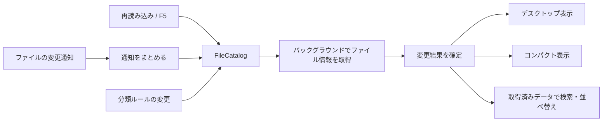

# Rainmeterの仕組みから採用したもの

共有された[Rainmeterの分析](https://chatgpt.com/s/cx_6af06c5386f081918749678f2350384b)を読み、アイコン整理に必要な仕組みだけを独立したC#実装へ取り入れています。Rainmeterのコードやプラグインを組み込んでいません。Laterarootのライセンスは引き続きMITです。

| 参考にした仕組み | Laterarootでの対応 |
| --- | --- |
| MeasureとMeterの分離 | `DesktopLibrary.ReadFiles`がファイル情報を取得し、`FileCatalog`が一つの変更結果を保持。デスクトップ用とコンパクト用の表示が共有します。 |
| 取得・表示更新・再描画を分ける | ファイル変更時だけ取得。並べ替え・検索は取得済みデータを使います。変更のないカテゴリのボタンや開いている別ジャンルの一覧を作り直しません。 |
| 操作時だけの更新 | 初回・ファイル通知・必要な分類変更・明示的な再読み込みで読みます。ファイル一覧を毎秒調べるタイマーはありません。 |
| Draggableと位置保存 | 「配置をロック」でドラッグを止めます。端への吸着・配置保存・復元は既存の設定を再利用します。設定画面からの配置変更は可能です。 |
| Action / Bang | `WidgetActions`に整理アプリの固定操作をまとめ、デスクトップ用とコンパクト用の右クリックで共有します。命令文を解釈する仕組みは作っていません。 |

Rainmeterの[Measure](https://docs.rainmeter.net/manual/measures/)と[Bang](https://docs.rainmeter.net/manual/bangs/)の役割分担、[Update=-1](https://docs.rainmeter.net/manual/skins/rainmeter-section/)の操作中心の更新、[Draggable / SnapEdges](https://docs.rainmeter.net/manual/settings/skin-sections/)を参考にしています。

## 更新と状態の扱い

v0.8開発版では、`<games>`を既存の分類ルールへ追加しています。`GameClassifier`はローカルのURLショートカットとWindows Shell Linkのメタデータを読むだけで、Resolveや起動はしません。結果をパス・サイズ・更新時刻で最大512件までキャッシュし、ゲームを探すための常駐プロセス・ドライブ全体の走査・アカウント連携を追加していません。分類の優先順位と収納ライブラリをそのまま使います。

並び順と昇降順は`FileCatalog.Order`に集約しています。右クリック・設定・インスペクターは同じ設定を保存し、取得済みのスナップショットを並べ替えます。アイコンのみ表示とジャンル用アイコンは表示設定のため、カタログを再取得しません。名前・色・アイコン・表示モードの変更がないカテゴリは引き続き作り直しません。

- 同時に取得する処理は一つです。処理中に新しい分類や変更要求が来た場合、古い結果を表示せず、最後の要求に追いつきます。
- 取得結果は変更できないスナップショットです。取得失敗時は最後の正常な結果を残し、再試行できます。
- ファイル通知は650msの単発待ちへまとめます。非表示・最小化中は新しい取得を保留し、戻ったときに更新します。既に始まっている読み取りは完了できます。
- メタデータ取得をUIスレッドで行いません。ファイル操作とメタデータ取得は既存のライブラリの排他制御を共有します。
- 「一覧を再読み込み」は監視を張り直して取得します。通知領域・カテゴリの右クリック・F5から同じ操作へ到達できます。
- 配置ロックはデスクトップ・コンパクト・最小化タブの移動ハンドルと、ドラッグ処理自体の両方で確認します。ファイルを開く操作は維持します。
- 整理の確認中・実行中は更新のための再起動を止めます。整理ボタンの重複操作もまとめて防ぎます。明示的な整理・復元以外ではファイルを動かしません。

## 採用しない範囲

時計、天気、CPU監視、音声解析、WebParser、Lua、プラグインDLL、INIスキン言語、`.rmskin`導入、汎用コマンド実行は追加しません。クリック透過はファイルを開く操作と衝突するため採用しません。独立したレイアウト保存形式や描画エンジンも増やさず、既存のJSON設定・WPF描画・2つの表示ウィンドウを使います。

## 検証

コアでは、バックグラウンド取得、重複要求の直列化、古い結果の破棄、スナップショットの不変性、失敗後の再試行、表示設定変更時の取得省略を確認します。UIでは実際のデモ用フォルダー通知、他ジャンルの更新時の表示保持、非表示・最小化からの復帰、配置ロック、手動再読み込み、既存の整理・復元を検証します。テストは隔離デモだけを使います。

## 全件復元と収納構造

`DesktopLibrary.RestoreAll` は表示中のリストではなく、永続化した履歴全体を対象にします。「すべて元に戻す」の有効状態も履歴から決め、ジャンル・検索・隠し属性で復元対象を落としません。個別復元は同じ `Restore` を再利用します。移動前の履歴保存と既存ファイルを上書きしない復元を維持します。手動で復元済みの項目は履歴を整理し、両方のパスで見つからない項目は履歴を残してエラーにします。

新規収納は1操作につき1つの `Vault/yyyy-MM-dd_HH-mm-ss[-n]` に元の名前でまとめます。旧版の `Vault/recordId/name` も読み込めます。終了した収納フォルダーは空の場合だけ非再帰で削除します。

+## カラーモード
+
+`ThemePalette` にライト／ダークの配色をまとめ、WPFの動的リソースで既存画面に反映します。ファイル一覧の再取得やウィジェットの作り直しは不要です。ジャンル色は別のユーザー設定として保持します。設定画面は自分のリソーススコープでプレビューし、保存が成功してからアプリ全体の配色を切り替えます。古い設定はライトを既定値として読み込みます。Windowsのハイコントラスト設定が有効な場合はシステム色を優先します。
+